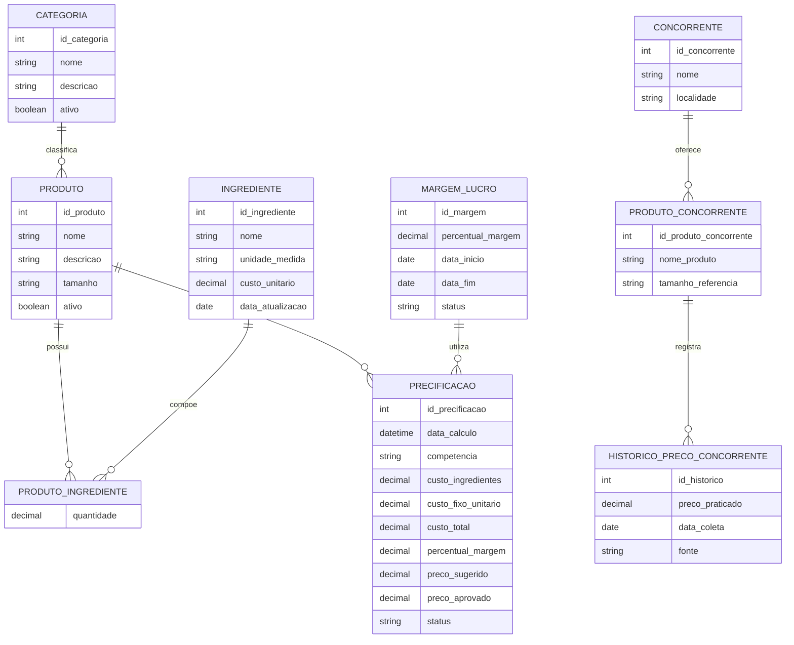

# DER conceitual (Mermaid)

**Observação:** o diagrama conceitual apresenta entidades e relacionamentos, sem atributos de chave estrangeira. As cardinalidades representam que cada produto pertence a uma categoria; uma pizza pode conter vários ingredientes e um ingrediente pode compor várias pizzas; cada precificação pertence a uma pizza e utiliza uma margem; cada concorrente oferece produtos comparáveis que podem ter várias coletas de preço.
