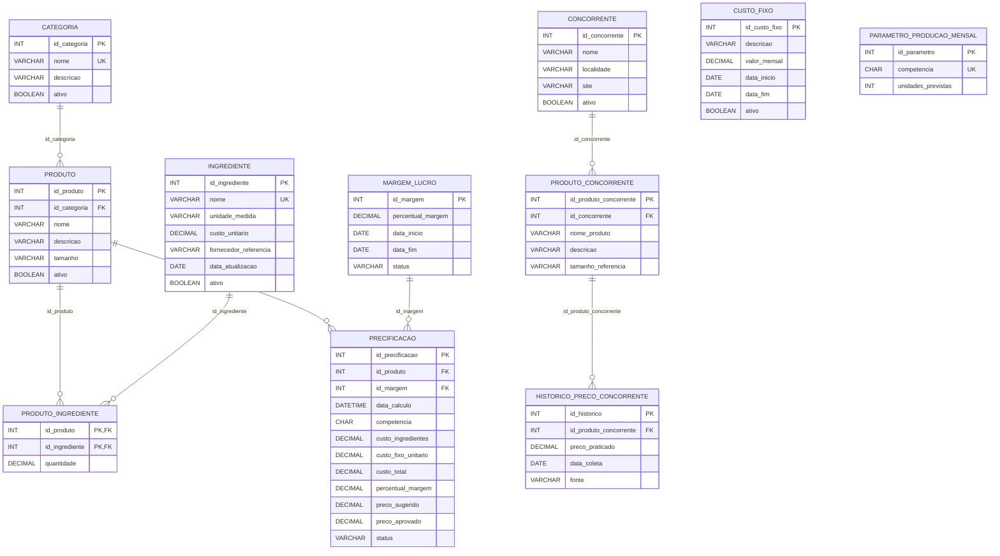

# Modelo lógico (Mermaid)

## Resumo de PKs e FKs
- PKs: identificadores `id_*`; em Produto_Ingrediente, PK composta (`id_produto`, `id_ingrediente`).
- FKs: Produto.id_categoria; Produto_Ingrediente.id_produto e id_ingrediente; Precificacao.id_produto e id_margem; Produto_Concorrente.id_concorrente; Historico_Preco_Concorrente.id_produto_concorrente.
- Cardinalidades: Categoria 1:N Produto; Produto N:N Ingrediente via associativa; Produto 1:N Precificacao; Margem 1:N Precificacao; Concorrente 1:N Produto_Concorrente; Produto_Concorrente 1:N Histórico.
